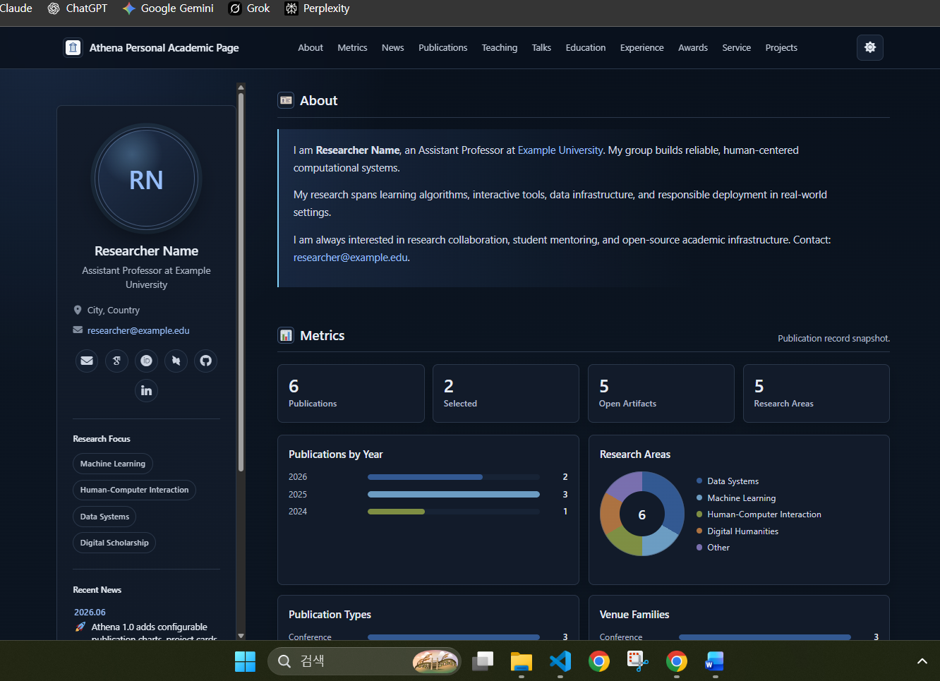
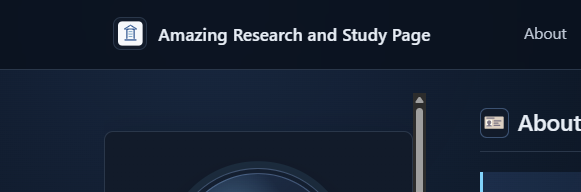
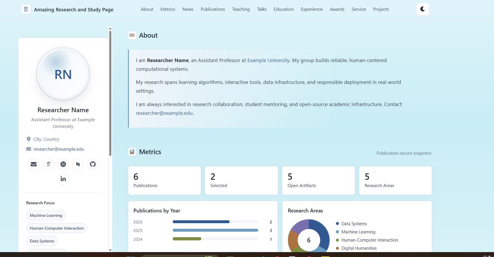
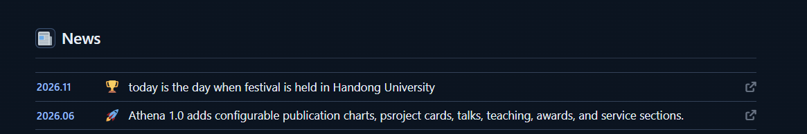

Athena Personal Academic Page 과제 정리

1. Project Information

(1)무슨 프로젝트인가 / 원본 정보
- 프로젝트 이름: Athena Personal Academic Page
- 원작자: AaronZ345
- 원본 URL: https://github.com/AaronZ345/Athena-personal-academic-page
- 라이선스: MIT (LICENSE 파일)
- 연구자 개인 학술 홈페이지 템플릿이며, React 19와 Vite 7로 만들어졌음.

(2)왜 골랐나
- 나중에 내가 논문을 쓸 때 활용할 수 있을 거 같아서 골랐음.

(3)주요 기능 2~3가지
- 라이트/다크 테마 전환 버튼으로 화면 분위기를 바꿀 수 있음.
- 상단 메뉴로 About, Metrics, News, Publications 등 섹션으로 이동할 수 있음.
- Metrics 섹션에서 논문 수와 연도별 그래프 같은 차트를 볼 수 있음.
- 창 너비에 맞게 레이아웃이 바뀌는 반응형 구조이며 데이터 파일만 고치면 화면이 바뀜.

2. Installation

(1)권장 Node 버전: 22 LTS

(2)설치 및 실행 명령어:

```
git clone https://github.com/AaronZ345/Athena-personal-academic-page.git
cd Athena-personal-academic-page
npm ci
npm run dev
```

(3)접속 주소: http://127.0.0.1:5173/

(4)실행 화면: 처음 실행한 다크 모드 캡처 1장을 첨부함.



3. Source Code Exploration

(1)주요 파일 2~3개의 역할
- src/content/ 폴더: 프로필, 논문, 뉴스, 프로젝트 등 사이트 내용이 파일별로 나뉘어 있음.
- src/content/site.js: 사이트 제목, 섹션 순서, 섹션 표시 여부를 정함.
- src/App.jsx: content 파일들을 읽어 화면을 그리는 페이지 컴포넌트들이 있음.
- vite.config.js: site.js를 불러와 제목과 설명을 index.html에 넣고, 배포 경로를 계산함.
- CSS 파일: :웹페이지의 색상을 꾸며줌.

(2)주요 컴포넌트 1~2개 / 코드 5~15줄 분석
```jsx
 news: (
      <div className="news-list">
        {news.map((item) => (
          <a className="news-row" href={item.href} key={`${item.date}-${item.text}`} target="_blank" rel="noreferrer">
            <time>{item.date}</time>
            <span className="news-icon" aria-hidden="true">
              <SemanticIcon icon={newsIconMap[item.icon] ?? newsIconMap.accepted} />
            </span>
            <span className="news-text">{item.text}</span>
            <i className="news-external fa-solid fa-arrow-up-right-from-square" aria-hidden="true" />
          </a>
        ))}
      </div>
    )
```

코드 분석: src/content/news.js에서 가져온 news 배열을 하나씩 꺼내서 각 항목 item마다 `<a>` 한 줄을 만든다. `` <a className="news-row" href={item.href} key={`${item.date}-${item.text}`} target="_blank" rel="noreferrer"> ``은 뉴스 항목 하나를 클릭하면 해당 뉴스 페이지를 새 탭에서 열도록 만드는 링크 기능을 한다. `<time>{item.date}</time>`은 날짜를 나타내는 기능이고 `<span className="news-icon" aria-hidden="true">
              <SemanticIcon icon={newsIconMap[item.icon] ?? newsIconMap.accepted} />
            </span>`은 icon={}을 통해 표시할 아이콘을 고르고 newsIconMap[item.icon]으로 item.icon에 해당하는 아이콘을 검색해서 뉴스 아이콘을 표시하는 기능이다. ?? newsIconMap.accepted은 만약 해당 아이콘이 없다면 기본 아이콘인 accepted를 쓰게 만드는 기능이다. `<span className="news-text">{item.text}</span>` 코드를 통해 item.text에 저장된 뉴스 내용을 표시하고 `<i className="news-external fa-solid fa-arrow-up-right-from-square" aria-hidden="true" />` 코드는 외부 링크 아이콘을 표시하는 기능이다. 

4. Customizing

(1)유형: Text
- 파일: src/content/site.js
- 변경 전: Athena Personal Academic Page
- 변경 후: Amazing Research and Study Page, 

(2)유형: Style
- 파일: src/styles.css
- 변경 전: 라이트 모드 흰색 배경, 흰 메뉴 바
- 변경 후: 청록 계열 배경(--page-bg, --background), 청록 메뉴 바(--header-bg), 

(3)유형: UI/Data
- 파일: src/content/news.js
- 변경 전: 최신 뉴스 2026.06
- 변경 후: 2026.11 한동대 축제 소식 추가 (award 아이콘, 한동대 홈페이지 링크), 

(4)주요 기능 확인: 테마 전환과 메뉴 이동이 정상 동작함.

(5)커밋 메시지:
- Change site title
- Change light theme background color
- Add Handong festival news item

5. Deployment

(1)Vercel URL: https://2026assign10-six.vercel.app

(2)Classroom 저장소: 2026-2-OSS/assign10-c01-22100072

(3)배포용 개인 저장소: kim-geun-won/2026_assign10

6. Weekly Review

(1)새로 배운 것 3가지
1. 다른 사람이 만든 오픈소스 프로젝트를 검색하고 가져오는 방법을 찾았다.
2. 웹 개발 사이트를 실행하는 명령어를 배웠다.
3. 코드 분석을 하면서 SemanticIcon가 어떤 기능을 하는지 배웠다.

(2)어려웠던 점과 해결
- 테마 선택자를 light로 바꿨더니 버튼이 반대로 동작해서 dark로 되돌리고 CSS 색상만 수정했음.
- 다크 블록에 라이트용 메뉴 색이 들어가 글자가 보이지 않아서 값을 되돌렸음.

(3)AI 활용 내용
- AI를 사용한 부분: 오픈소스 후보 추천, 색상 코드 추천, 코드 분석에서 {`${item.date}-${item.text}`}와 SemanticIcon이 무엇인지 물어보았음. 
- 직접 한 부분: 프로젝트 선택, 모든 코드 수정, 커밋과 배포, README 작성.

(4)느낀 점
- 다른 사람이 만든 오픈소스 프로젝트를 직접 가져와서 내가 변형하고 싶은대로 고치는 경험이 재미있었다.